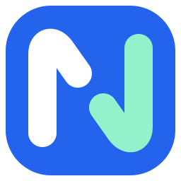

# 邻传 NearLink

让文件和消息，在身边的设备间轻松流动。

邻传是一款面向 **Windows 与 Android** 的局域网文件传输与即时沟通工具。无需注册账号，也不用借助网盘，在同一可互通局域网内，就能在自己的手机、电脑之间传文件，或与同事聊天、分享资料。

## 功能亮点

- **附近设备，快速互传**：自动发现局域网内的设备，选择对方即可发送；也支持手动连接和设备备注，常用设备更好找。
- **各种文件，一起发送**：支持图片、视频、文档等任意类型文件，可批量发送；Windows 还支持文件夹与拖拽添加，保留文件夹层级。
- **聊天传文件，不用切换页面**：在对话中直接发送文字和文件，查看传输进度、速度与结果，让沟通和资料分享保持连贯。
- **多人群组，协作更方便**：创建局域网群组，支持群聊与文件群发，分别查看成员的消息送达和文件传输结果。
- **大文件，传输状态清晰**：采用流式传输与完整性校验，实时显示进度和速率，支持取消与失败重试。
- **截图批注，随手分享**：Windows 支持全局快捷键截图，可添加矩形、椭圆、箭头、画笔和文字，完成后复制、保存或加入待发送列表。
- **消息与文件，及时提醒**：支持未读数量、文件接收和传输完成提醒；Windows 提供桌面通知、托盘红点与闪烁、任务栏角标，提示音可独立开关。
- **传输记录，随时查找**：集中查看发送与接收记录，了解传输结果，快速找到已接收的文件。

## 为电脑和手机分别设计

**Windows**

一体化自定义标题栏与可收起的侧边导航，适合日常办公和多任务操作。支持托盘常驻、关闭行为设置、开机自启，以及可自定义的截图快捷键；提供安装版和便携版。

**Android**

采用适合触控的手机布局，围绕发送、消息、设备、记录和设置组织常用操作。支持系统文件与媒体选择、从其他应用分享文件到邻传，以及接收后的打开、另存和分享。

## 简约外观，顺手使用

以清爽的蓝白与薄荷绿搭配，延续电脑和手机上一致的年轻化主题。首页优先呈现快速发送，会话中的文件卡片直接展示进度，接收请求以悬浮提示呈现，常用操作围绕当前任务展开。

文件在设备之间直接传输，不经过云端；聊天记录、设备备注与个人设置保存在本机，兼顾个人跨设备使用与同事间的日常协作。

> 两端打开邻传并连接同一可互通局域网，即可开始使用。
